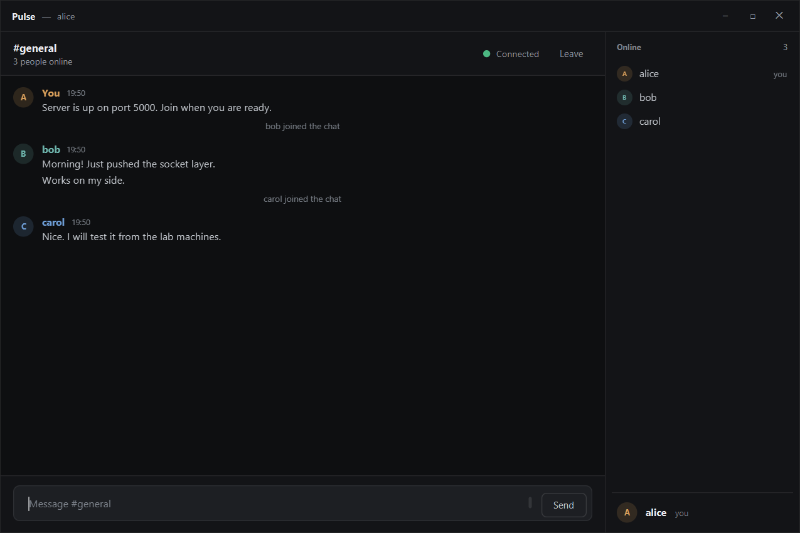
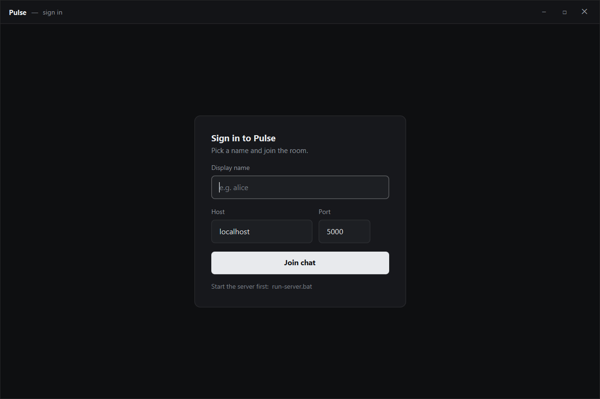
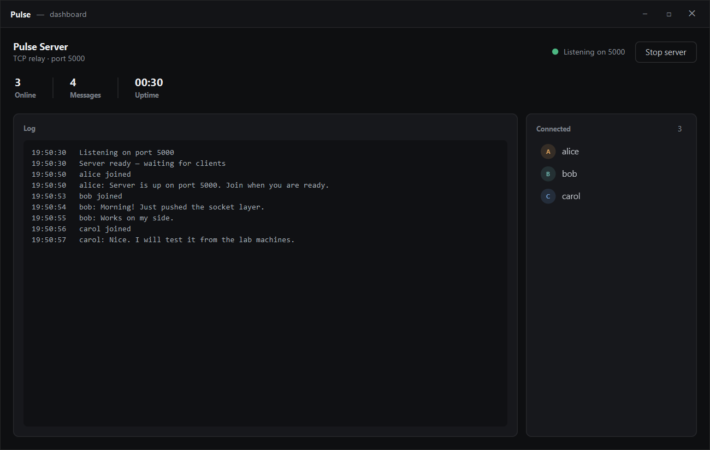
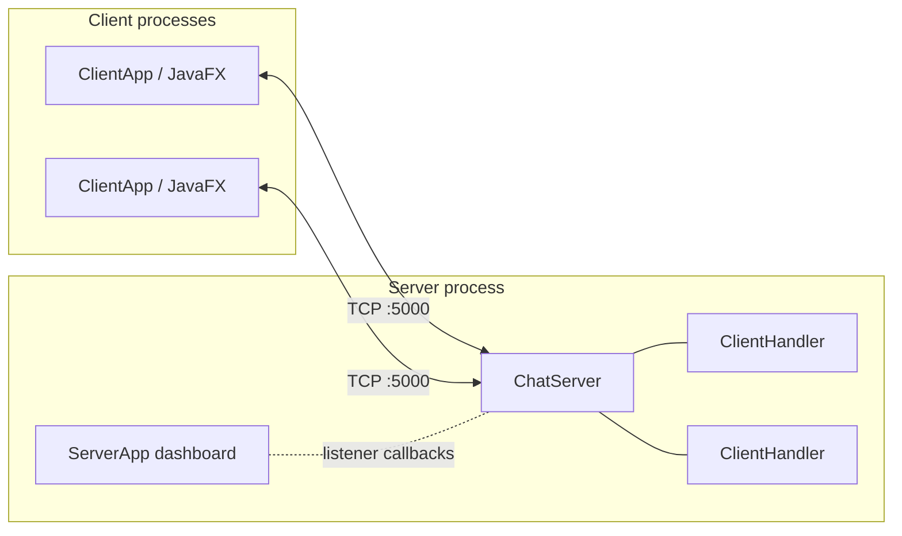

# Pulse

Pulse is a small group chat: a multithreaded TCP server and a JavaFX desktop
client. The server has its own window with a live log and a list of connected
people, so you can watch connections and messages arrive while the clients
talk.

It was built as a third-year university project, with the networking layer kept
separate from the UI so the server can be tested without opening a window.



| Sign in | Server dashboard |
| --- | --- |
|  |  |

## Features

- Group chat over a raw TCP socket. The server relays every message to every
  connected client.
- A server dashboard with a live log, connected users, message count, uptime,
  and start/stop controls.
- Display names are validated (2 to 16 letters, digits or underscores) and
  unique regardless of case.
- Join and leave notices, a member list, timestamps, and one muted colour per
  person.
- Messages read as a single column: name, time and text, with a run of messages
  from one person grouped under one header. Your own lines use the same layout
  and are labelled "You". The list stays pinned to the newest message.
- A banner and an offline indicator when the connection drops, with the
  composer disabled until you rejoin.
- Clean leave: the client sends `QUIT`, so other people see "left the chat"
  instead of a dropped socket.
- Optional auto-join from environment variables (the batch files turn a
  command-line argument into one), which is what `demo.bat` uses.
- Ten JUnit tests, including socket-level tests against a real server on an
  ephemeral port.

## Requirements

- JDK 17 or newer. Tested on JDK 26.
- Maven 3.8 or newer.
- Windows for the batch files. The Maven commands work on macOS and Linux too.

JavaFX is pulled from Maven, so there is no SDK to install.

## Running it

### With the batch files

1. `build.bat` once. The first run downloads JavaFX.
2. `run-server.bat`. The dashboard opens and starts listening on port 5000.
3. `run-client.bat` for each person. Run it again for a second window, or pass
   a name: `run-client.bat bob`.

`demo.bat` starts a server and three clients (alice, bob, carol) with a short
delay between them.

### With Maven

```
mvn clean package
mvn javafx:run -Pserver
mvn javafx:run
```

The `server` profile selects `com.pulse.server.ServerApp`; the default is the
client. The server port can be changed with `PULSE_PORT`, and the client reads
`PULSE_NAME`, `PULSE_HOST` and `PULSE_PORT` on startup.

## Using it

- Enter a name, leave the host as `localhost` if the server is on the same
  machine, and press **Join chat**.
- **Enter** sends a message; **Shift+Enter** starts a new line. Messages are
  capped at 2,000 characters.
- **Leave** disconnects and returns to the sign-in screen.
- The server window's **Stop server** button closes the listening socket
  without closing the window. **Start server** brings it back on the same port.

## How it works



### Threads

- `ChatServer` runs one acceptor thread. Each accepted socket gets a
  `ClientHandler` on its own thread, which blocks in `readUTF()`.
- Handlers are kept in a `ConcurrentHashMap` keyed by the lower-case name, so
  the duplicate-name check is atomic.
- All writes to a client go through a synchronized `send`, because a message
  can arrive from another client's thread while the server is replying to that
  client.
- The server and client networking classes have no JavaFX imports. The windows
  subscribe through listener interfaces, and every UI update hops to the
  JavaFX thread with `Platform.runLater`.

### Protocol

Every frame is a single `writeUTF` string. Fields are separated by the ASCII
unit separator (`0x1F`), which will not appear in a chat message, so no escaping
is needed.

| Direction | Type | Fields | Meaning |
| --- | --- | --- | --- |
| client → server | `JOIN` | name | first frame on a new connection |
| client → server | `MSG` | text | send a chat message |
| client → server | `USERS` | | ask for the current user list |
| client → server | `QUIT` | | leave without waiting for the socket to drop |
| server → client | `WELCOME` | name | join accepted |
| server → client | `CHAT` | sender, text | relayed message |
| server → client | `SYSTEM` | text | join or leave notice |
| server → client | `USERLIST` | names... | everyone currently connected |
| server → client | `ERROR` | reason | join rejected |

`writeUTF` has a 65,535-byte limit, which is comfortable for a 2,000-character
message. A production protocol would probably length-prefix a byte array
instead.

### Layout

```
pom.xml
build.bat  run-server.bat  run-client.bat  demo.bat
src/main/java/com/pulse/
  Protocol.java              frame encoding and constants
  client/ChatClient.java     socket, reader thread, callbacks
  client/ClientApp.java      sign-in and chat windows
  server/ChatServer.java     accept loop, registry, broadcast
  server/ClientHandler.java  one connection, name rules, message limit
  server/ServerApp.java      dashboard
  ui/Avatar.java             initials avatar
  ui/Theme.java              scene helpers and colour choice
  ui/WindowChrome.java       borderless window, drag and resize
src/main/resources/com/pulse/
  app.css                    all styling and colour tokens
  icon.png
src/test/java/com/pulse/
  ProtocolTest.java
  server/ChatServerTest.java
docs/
  DESIGN.md                  colour, type and layout decisions
  *.png                      screenshots
```

## Tests

```
mvn test
```

`ProtocolTest` covers frame building and splitting. `ChatServerTest` starts a
real server on port 0 and connects real sockets to check the welcome handshake,
duplicate names, name validation, message delivery, and the user list.

## Notes and limits

- One room. There are no private messages, channels, or message history; when
  the server stops, the conversation is gone.
- No authentication and no encryption. Run it on a trusted network, not on the
  open internet.
- Timestamps are added by each client when a message arrives, not by the
  server.
- The layouts target a desktop window and have minimum sizes of 900×600 for the
  client and 900×560 for the server.

The visual decisions are written down in [docs/DESIGN.md](docs/DESIGN.md).
